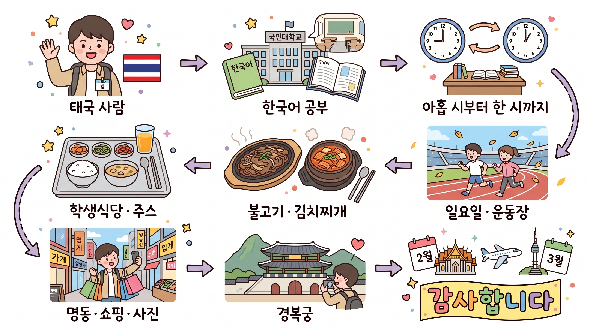

# 발표 · 자기 소개 (บทพูดแนะนำตัว)

**ผู้พูด:** 빔 (บีม) · **นำเสนอ:** พุธ 21 ต.ค. 2026 (วันก่อนสอบพูดกลางภาค) · **ทั้งบทเป็น 합니다체** (입니다 · 습니다 · 았/었습니다 · 겠습니다 · 것입니다) ไม่มี -요 · **บทที่เกี่ยวข้อง:** 5과 입니다 · 16과 -ㅂ니다/습니다 · -겠습니다 · 12과 에서 · 13과 하고 · 17과 -았/었- · 18과 부터 ~까지 · 19과 -(으)ㄹ 것 · 20과 자주 · 도

**สารบัญ**

[TOC]

---

## ✏️ ที่ปรับจากร่างเดิม

- **ตัดส่วนครอบครัวออกทั้งหมด** ตามที่อาจารย์บอกว่าการแนะนำตัวไม่ต้องเล่าเรื่องครอบครัว
- **เปลี่ยนทุกประโยคเป็นรูปทางการ 합니다체** ตามที่คุณต้องการ: 공부해요 → 공부합니다 · 왔어요 → 왔습니다 · 갈 거예요 → 갈 것입니다 · 공부할 거예요 → 공부하겠습니다 (ตั้งใจ)
- ประโยคเดิมของคุณ (1–2, 4, 6–7 ในเลขใหม่) เก็บเนื้อหาไว้ครบ เปลี่ยนแค่ท้ายประโยค
- เติมส่วน **취미와 주말** (งานอดิเรกกับสุดสัปดาห์) และ **계획** (แผน) แทนครอบครัว รวม 15 ประโยคเท่าเดิม
- **20 ต.ค.:** เพิ่มส่วน **전공과 장학금** (ป.โท วิศวกรรมเครื่องกล · หุ่นยนต์สองขามีล้อ · ทุนรัฐบาลเกาหลี) เป็นประโยค 2 (ทุน ต่อจากชื่อทันที) และ 4–6 (สาขา · หุ่นยนต์) แล้วเรียงใหม่ทั้งบท รวม 19 ประโยค

| ประโยคที่เติม/ปรับ | ไวยากรณ์ | ถ้าไม่ตรงความจริง |
|:---|:---|:---|
| 저는 올해 한국에 왔습니다. | 17과 -았습니다 | มาปีที่แล้ว → 작년에 |
| 매일 아홉 시부터 한 시까지 한국어를 배웁니다. | 18과 부터 ~까지 | เปลี่ยนเวลาเรียนจริง |
| 저는 운동을 아주 좋아합니다. 그리고 한국 음식도 좋아합니다. | 도 (14과) | เปลี่ยน 운동 เป็น 음악 · 영화 ได้ |
| 불고기하고 김치찌개를 자주 먹습니다. | 하고 · 자주 (20과) | ใส่เมนูที่ชอบจริง |
| 주말에 친구하고 같이 명동에 갑니다. 거기에서 쇼핑을 합니다. 사진도 찍습니다. | 에 가다 · 에서 + 동사 | เปลี่ยนสถานที่ได้ (홍대 · 인사동) |
| 지난 주말에 경복궁에 갔습니다. 경치가 아주 좋았습니다. | 17과 อดีต | ถ้ายังไม่เคยไป → 다음 주말에 경복궁에 갈 것입니다 |
| 저는 한국어를 열심히 공부하겠습니다. 한국 친구도 많이 만나겠습니다. | 16과 -겠습니다 (ตั้งใจ) | — |
| 이월에 태국에 갈 것입니다. 그리고 삼월에 한국에 올 것입니다. | 19과 -(으)ㄹ 것입니다 | เชื่อมกับบทพูด 방학 계획 (15 ก.พ. – 15 มี.ค.) |

---

## 📢 บทพูดเต็ม (발표문)

> 💡 อ่านบรรทัด **ตัวหนาเกาหลี** ออกเสียงจริง · คำอ่านไทยกับความหมายมีไว้ซ้อม

### 시작 (เปิด)

**1. 안녕하십니까? 저는 빔입니다.**
*อันนยองฮาชิมนีกา? ชอนึน บีม-อิมนีดา*
🇹🇭 สวัสดีครับ ผมชื่อบีมครับ

**2. 저는 한국 정부 장학생입니다.**
*ชอนึน ฮันกุก ชองบู ชังฮักแซง-อิมนีดา*
🇹🇭 ผมเป็นนักเรียนทุนรัฐบาลเกาหลีครับ

**3. 태국 사람입니다. 국민대학교 학생입니다.**
*แทกุก ซารัม-อิมนีดา. คุงมินแดฮักกโย ฮักแซง-อิมนีดา*
🇹🇭 ผมเป็นคนไทย เป็นนักศึกษามหาวิทยาลัยกุกมินครับ

### 전공 (สาขาและงานวิจัย)

**4. 저는 대학원생입니다. 기계공학과에서 로봇을 공부합니다.**
*ชอนึน แทฮักวอนแซง-อิมนีดา. คีกเยคงฮักกวา-เอซอ โรบซึล คงบูฮัมนีดา*
🇹🇭 ผมเป็นนักศึกษาปริญญาโท เรียนเรื่องหุ่นยนต์ที่ภาควิชาวิศวกรรมเครื่องกลครับ

**5. 저는 로봇을 만듭니다. 제 로봇은 다리가 두 개 있습니다. 그리고 바퀴도 있습니다.**
*ชอนึน โรบซึล มันดึมนีดา. เช โรบซึน ทารีกา ทู แก อิดซึมนีดา. คือรีโก พากวี-โด อิดซึมนีดา*
🇹🇭 ผมสร้างหุ่นยนต์ครับ หุ่นยนต์ของผมมีขาสองขา แล้วก็มีล้อด้วยครับ

**6. 이 로봇은 걷습니다. 그리고 점프도 합니다.**
*อี โรบซึน คอดซึมนีดา. คือรีโก ชอมพือ-โด ฮัมนีดา*
🇹🇭 หุ่นยนต์ตัวนี้เดินได้ แล้วก็กระโดดได้ด้วยครับ

### 한국 생활 (ชีวิตในเกาหลี)

**7. 저는 올해 한국에 왔습니다.**
*ชอนึน โอแร ฮันกุก-เก วัดซึมนีดา*
🇹🇭 ผมมาเกาหลีปีนี้ครับ

**8. 지금 한국어교육센터에서 한국어를 공부합니다.**
*ชีกึม ฮันกูกอ-คโยยุก-เซนทอ-เอซอ ฮันกูกอ-รึล คงบูฮัมนีดา*
🇹🇭 ตอนนี้เรียนภาษาเกาหลีที่ศูนย์ภาษาเกาหลีครับ

**9. 매일 아홉 시부터 한 시까지 한국어를 배웁니다.**
*แมอิล อาฮบ ชี-บูทอ ฮัน ชี-กาจี ฮันกูกอ-รึล แพอุมนีดา*
🇹🇭 เรียนภาษาเกาหลีทุกวันตั้งแต่เก้าโมงถึงบ่ายโมงครับ

**10. 저는 매일 오전에 학생식당에서 음식을 먹습니다. 그리고 주스를 마십니다.**
*ชอนึน แมอิล โอจอน-เน ฮักแซงชิกตัง-เอซอ อึมชีกึล มอกซึมนีดา. คือรีโก จูซือ-รึล มาชิมนีดา*
🇹🇭 ทุกวันตอนเช้าผมกินข้าวที่โรงอาหารนักศึกษา แล้วก็ดื่มน้ำผลไม้ครับ

**11. 저는 한국 날씨를 좋아합니다. 한국 생활이 재미있습니다.**
*ชอนึน ฮันกุก นัลชี-รึล โชอาฮัมนีดา. ฮันกุก แซงฮวัล-รี แชมีอิดซึมนีดา*
🇹🇭 ผมชอบอากาศเกาหลี ชีวิตในเกาหลีสนุกครับ

### 취미와 주말 (งานอดิเรกและสุดสัปดาห์)

**12. 저는 운동을 아주 좋아합니다. 그리고 한국 음식도 좋아합니다.**
*ชอนึน อุนดงอึล อาจู โชอาฮัมนีดา. คือรีโก ฮันกุก อึมชิก-โต โชอาฮัมนีดา*
🇹🇭 ผมชอบออกกำลังกายมาก แล้วก็ชอบอาหารเกาหลีด้วยครับ

**13. 불고기하고 김치찌개를 자주 먹습니다.**
*พุลโกกี-ฮาโก คิมชีจจีแก-รึล ชาจู มอกซึมนีดา*
🇹🇭 ผมกินพุลโกกีกับคิมชีจจีแกบ่อย ๆ ครับ

**14. 저는 일요일에 친구하고 같이 운동장에서 달립니다.**
*ชอนึน อีรโยอิล-เร ชินกู-ฮาโก คาชี อุนดงจัง-เอซอ ทัลลิมนีดา*
🇹🇭 วันอาทิตย์ผมวิ่งที่สนามกีฬากับเพื่อนครับ

**15. 주말에 친구하고 같이 명동에 갑니다. 거기에서 쇼핑을 합니다. 사진도 찍습니다.**
*ชูมัล-เร ชินกู-ฮาโก คาชี มยองดง-เอ คัมนีดา. คอกี-เอซอ ชโยพิงอึล ฮัมนีดา. ซาจิน-โด จจิกซึมนีดา*
🇹🇭 สุดสัปดาห์ผมไปมยองดงกับเพื่อน ที่นั่นผมช้อปปิ้ง แล้วก็ถ่ายรูปด้วยครับ

**16. 지난 주말에 경복궁에 갔습니다. 경치가 아주 좋았습니다.**
*ชีนัน ชูมัล-เร คยองบกกุง-เอ คัดซึมนีดา. คยองชี-กา อาจู โชอัดซึมนีดา*
🇹🇭 สุดสัปดาห์ที่แล้วผมไปพระราชวังคยองบกกุง วิวสวยมากครับ

### 끝 (ปิด)

**17. 저는 한국어를 열심히 공부하겠습니다. 한국 친구도 많이 만나겠습니다.**
*ชอนึน ฮันกูกอ-รึล ยอลชีมี คงบูฮาเก็ดซึมนีดา. ฮันกุก ชินกู-โด มานี มันนาเก็ดซึมนีดา*
🇹🇭 ผมจะตั้งใจเรียนภาษาเกาหลี และจะหาเพื่อนชาวเกาหลีเยอะ ๆ ครับ

**18. 이월에 태국에 갈 것입니다. 그리고 삼월에 한국에 올 것입니다.**
*อีวอล-เร แทกุก-เก คัล กอชิมนีดา. คือรีโก ซามวอล-เร ฮันกุก-เก อล กอชิมนีดา*
🇹🇭 เดือนกุมภาผมจะกลับไทย แล้วเดือนมีนาจะกลับมาเกาหลีครับ

**19. 감사합니다.**
*คัมซาฮัมนีดา*
🇹🇭 ขอบคุณครับ

#### คำใหม่ของประโยคที่เพิ่ม 20 ต.ค. (2 และ 4–6)

| คำใหม่ | อ่าน | ความหมาย | หมายเหตุ |
|:---|:---|:---|:---|
| 대학원생 | แทฮักวอนแซง | นักศึกษาบัณฑิตศึกษา (ป.โท/เอก) | 대학원 = บัณฑิตวิทยาลัย · 대학생 = ป.ตรี |
| 기계공학과 | คีกเยคงฮักกวา | ภาควิชาวิศวกรรมเครื่องกล | 과 = ภาควิชา (เหมือน 법대·경영학과) |
| 로봇 | โรบด | หุ่นยนต์ | คำยืม · 로봇을 [โรบซึล] |
| 만듭니다 | มันดึมนีดา | สร้าง/ทำ (만들다) | ⚠️ ㄹ หายก่อน ㅂ니다 — ไม่ใช่ 만들습니다 |
| 다리 · 바퀴 | ทารี · พากวี | ขา · ล้อ | 다리가 두 개 = ขาสองขา (นับด้วย 개) |
| 걷습니다 | คอดซึมนีดา | เดิน (걷다) | ออกเสียง [걷씀니다] |
| 점프하다 | ชอมพือฮาดา | กระโดด | คำยืม jump · 점프도 합니다 = กระโดดด้วย |
| 정부 · 장학생 | ชองบู · ชังฮักแซง | รัฐบาล · นักเรียนทุน | เต็ม ๆ: 한국 정부 장학금으로 왔습니다 (으로 = ด้วย) |

> 💡 ถ้าครูถามต่อ: **무슨 로봇이에요?** → 다리가 두 개 있는 바퀴 로봇입니다 · **로봇이 뭘 해요?** → 걷습니다. 그리고 점프합니다 · **왜 한국에 왔어요?** → 한국 정부 장학생입니다. 그래서 한국에 왔습니다

## 🖼️ ภาพประกอบการนำเสนอ (발표 그림)

ภาพเดียวครอบคลุมบทพูดทั้ง 15 ประโยค — ชี้ตามลูกศรขณะพูด (แถวบนซ้ายไปขวา · แถวกลางขวาไปซ้าย · แถวล่างซ้ายไปขวา):

| ฉากในภาพ | ประโยค | พูดว่า |
|:---|:---:|:---|
| 👋 빔 · ธงไทย **태국 사람** | 1–2 | 안녕하십니까? 저는 빔입니다. 태국 사람입니다. 국민대학교 학생입니다. |
| 🏫 국민대학교 · **한국어 공부** | 3–4 | 올해 한국에 왔습니다. 한국어교육센터에서 한국어를 공부합니다. |
| 🕘 นาฬิกา 9:00 → 1:00 **아홉 시부터 한 시까지** | 5 | 매일 아홉 시부터 한 시까지 한국어를 배웁니다. |
| 🏃 **일요일 · 운동장** (ใบไม้ร่วง = 한국 날씨) | 7 · 8 · 10 | 한국 날씨를 좋아합니다. 운동을 아주 좋아합니다. 일요일에 친구하고 같이 운동장에서 달립니다. |
| 🍲 **불고기 · 김치찌개** | 8–9 | 한국 음식도 좋아합니다. 불고기하고 김치찌개를 자주 먹습니다. |
| 🍱 **학생식당 · 주스** | 6 | 매일 오전에 학생식당에서 음식을 먹습니다. 그리고 주스를 마십니다. |
| 🛍️ **명동 · 쇼핑 · 사진** | 11 | 주말에 친구하고 같이 명동에 갑니다. 거기에서 쇼핑을 합니다. 사진도 찍습니다. |
| 🏯 **경복궁** | 12 | 지난 주말에 경복궁에 갔습니다. 경치가 아주 좋았습니다. |
| 📅 2월 ✈ 3월 · **감사합니다** | 13–15 | 한국어를 열심히 공부하겠습니다. 이월에 태국에 갈 것입니다. 삼월에 한국에 올 것입니다. 감사합니다. |

ลำดับในภาพต่างจากบทพูดเล็กน้อย (ฉาก 운동장 มาก่อน 불고기 และ 학생식당) — ถ้าจะให้ตรงบท ให้ชี้ 학생식당 (ประโยค 6) ก่อน แล้วค่อยย้อนไป 운동장 · 불고기 หรือพูดตามภาพแล้วสลับประโยค 6 ไปไว้หลังประโยค 9 ก็ได้ ความหมายไม่เสีย · ไฟล์ `content/speaking/myself.jpeg` (รูปที่คุณสร้างจาก AI) พิมพ์ A4 แนวนอนหรือเปิดบนมือถือให้เพื่อนดูได้

---

## ❓ คำถามที่ครูอาจถามต่อ (질문 연습)

ครูถามด้วย -요 ได้ แต่คุณตอบด้วย 합니다체 ให้สม่ำเสมอ

| ครูถาม | ตอบ |
|:---|:---|
| 고향이 어디예요? *(บ้านเกิดอยู่ไหน)* | 방콕입니다. |
| 태국에서 뭐 했어요? *({p:ที่}{n:ไทย}{v:ทำ}{q:อะไร}{e:มาก่อน})* | 대학교에 다녔습니다. / 회사에서 일했습니다. *(เลือกที่ตรงจริง)* |
| 무슨 운동을 좋아해요? *(ชอบกีฬาอะไร)* | 달리기를 좋아합니다. 수영도 좋아합니다. |
| 한국에서 어디에 갔어요? *({p:ใน}{n:เกาหลี}{v:ไป}{q:ที่ไหน}{e:มาแล้ว})* | 명동하고 경복궁에 갔습니다. |
| 주말에 보통 뭐 해요? *(สุดสัปดาห์ปกติทำอะไร)* | 친구하고 같이 쇼핑을 합니다. 그리고 집에서 쉽니다. |
| 한국 음식 중에서 뭐가 제일 맛있어요? *(อาหารเกาหลีอะไรอร่อยที่สุด)* | 불고기가 제일 맛있습니다. *(제일 = ที่สุด)* |

---

## 📚 คำศัพท์ (단어)

| 단어 | คำอ่าน | ความหมาย |
|:---|:---|:---|
| 올해 | โอแร | ปีนี้ |
| 한국어교육센터 | ฮันกูกอคโยยุกเซนทอ | ศูนย์ภาษาเกาหลี |
| 배우다 | แพอูดา | เรียน (จากครู) |
| 학생식당 | ฮักแซงชิกตัง | โรงอาหารนักศึกษา |
| 날씨 | นัลชี | อากาศ |
| 생활 | แซงฮวัล | ชีวิต การใช้ชีวิต *(สะกด ㅎ+ㅘ+ㄹ — เคยเขียนผิดเป็น 생할)* |
| 운동 | อุนดง | การออกกำลังกาย กีฬา |
| 불고기 · 김치찌개 | พุลโกกี · คิมชีจจีแก | เนื้อผัดซอส · ซุปกิมจิ |
| 자주 | ชาจู | บ่อย ๆ |
| 운동장 | อุนดงจัง | สนามกีฬา |
| 달리다 | ทัลรีดา | วิ่ง (달립니다) |
| 명동 | มยองดง | ย่านมยองดง (ช้อปปิ้ง) |
| 쇼핑을 하다 | ชโยพิงอึล ฮาดา | ช้อปปิ้ง |
| 사진을 찍다 | ซาจินึล จจิกตา | ถ่ายรูป |
| 경복궁 | คยองบกกุง | พระราชวังคยองบกกุง *(22과)* |
| 경치 | คยองชี | วิว ทิวทัศน์ *(19과)* |
| 열심히 | ยอลชีมี | อย่างตั้งใจ *(สะกด 히 — เคยเขียน 열심이)* |

---

## ⚠️ จุดที่ต้องระวังตอนพูด

### 1. ทั้งบทเป็น 합니다체 — วิธีผัน

| รูป | เงื่อนไข | ในบทนี้ |
|:---|:---|:---|
| N**입니다** | คำนาม | 빔입니다 · 학생입니다 · 방콕입니다 |
| V**-ㅂ니다** | รากไม่มีตัวสะกด | 공부합니다 · 배웁니다 · 마십니다 · 갑니다 · 합니다 |
| V**-습니다** | รากมีตัวสะกด | 먹습니다 · 찍습니다 · 재미있습니다 |
| V**-았/었습니다** | อดีต | 왔습니다 · 갔습니다 · 좋았습니다 |
| V**-겠습니다** | ตั้งใจจะ (16과) | 공부하겠습니다 · 만나겠습니다 |
| V**-(으)ㄹ 것입니다** | อนาคต/แผน = 거예요 แบบทางการ | 갈 것입니다 · 올 것입니다 |
| ⚠️ ราก ㄹ | 달리다 → 달립니다 (ไม่มี ㄹ ตก เพราะราก 달리 ไม่มีตัวสะกด) · 살다 → 삽니다 (ㄹ ตกก่อน ㅂ) | 달립니다 |

ไม่มีประโยคไหนลงท้าย -요 · ถ้าครูถามด้วย -요 ก็ยังตอบ 합니다 ตามตาราง

### 2. 도 แทน 을/를 เมื่อพูดว่า "…ด้วย"

한국 음식**도** 좋아합니다 · 사진**도** 찍습니다 · 한국 친구**도** 많이 만나겠습니다 — 도 เข้าแทนที่ 을/를 ไม่ใช่ต่อท้าย (✗ 음식을도)

### 3. 에 กับ 에서 ในประโยค 11

명동**에** 갑니다 (จุดหมาย) → 거기**에서** 쇼핑을 합니다 (ที่ทำกิจกรรม) — คู่เดียวกับที่เคยผิด 백화점에 샀어요

### 4. 에 หลังคำบอกเวลา

오전**에** · 일요일**에** · 주말**에** · 지난 주말**에** · 이월**에** ต้องมี · 매일 · 지금 ห้ามมี (ประโยค 4–6 ถูกแล้ว)

### 5. อดีตของ 좋다 และ 가다

좋다 → 좋**았**습니다 (ㅗ จับคู่ 았) · 가다 → 갔습니다 (가 + 았 → 갔) — ระวังอย่าพูด 좋었습니다 (ปัญหาเดิม 살어요)

### 6. การออกเสียงที่มักพลาด

| เขียน | อ่านจริง | หมายเหตุ |
|:---|:---|:---|
| 습니다 | [씀니다] | ㅅ หลังตัวสะกดออกเสียงหนัก · ㅂ หน้า ㄴ → ㅁ |
| 왔습니다 · 갔습니다 | [왇씀니다] · [갇씀니다] | |
| 것입니다 | [거심니다] | ㅅ เลื่อนไปเกาะ 입 |
| 갑니다 · 합니다 | [감니다] · [함니다] | ㅂ หน้า ㄴ → ㅁ |
| 국민대학교 | [궁민대학꾜] | ㄱ หน้า ㅁ กลายเป็น ㅇ |
| 학생식당 | [학쌩식땅] | ㅅ/ㄷ หลังตัวสะกดออกเสียงหนัก |
| 같이 | [가치] | ㅌ + 이 → 치 |
| 좋아합니다 · 좋았습니다 | [조아함니다] · [조아씀니다] | ㅎ เงียบ |
| 경복궁에 | [경복꿍에] | 궁 ออกเสียงหนัก |
| 열심히 | [열씨미] | ㅎ เงียบ · 심 ออกเสียงหนัก |

### 7. ซ้อมพูด

1. 15 ประโยค ≈ **60–70 วินาที** · ถ้าครูจำกัด 1 นาที ตัดประโยค 3 หรือ 12 ออกได้
2. โครงที่ซ้ำกัน ช่วยให้พูดคล่อง: 저는 … 좋아합니다 (ประโยค 7–8) · … 에 갑니다/갔습니다 (11–12) · … 겠습니다 / 것입니다 (13–14)
3. ซ้อมหน้ากระจกโดย**ไม่ดูคำอ่านไทย** อย่างน้อย 3 รอบ
4. วันที่ 22 สอบพูดกลางภาค — ครูมักถามจากบทนี้ต่อ ซ้อมตารางคำถาม (หัวข้อ 3) ด้วย ตอบ 합니다 ให้ติดปาก
