# 발표 · 여행 소개 — 청두 (บทพูดเล่าเรื่องเที่ยวเฉิงตู)

**ผู้พูด:** 빔 (บีม) · **นำเสนอ:** อังคาร 24 พ.ย. 2026 (기말 발표) · **โจทย์:** ใบงาน「쓰고 발표하기」*(เขียนแล้วออกมานำเสนอ)* ของครู 2 หน้า · **รูปแบบ:** -(스)ㅂ니다 ทั้งเรื่อง ตาม <보기> 제주도 ของครู

**สารบัญ**

[TOC]

---

## 🎯 โจทย์ของอาจารย์ (ใบงาน 쓰고 발표하기)

ใบงานมี 2 ข้อ ข้อ 1 ให้ตอบตาราง 16 คำถามเรื่องที่เที่ยวที่เคยไป ข้อ 2 ให้เขียนบทพูดตาม <보기> แล้วนำมาพูด

| ส่วน | สิ่งที่ต้องทำ |
|:---|:---|
| **1. 여러분이 여행한 곳은 어디예요?** *(ที่ที่ทุกคนเคยไปเที่ยวคือที่ไหน)* | ตอบตาราง 6 หมวด 16 คำถาม ในช่อง "내가 여행한 곳: ___" *(ที่ที่ฉันไปเที่ยว)* · ช่องตัวอย่างของครูคือ "내가 여행한 곳: 제주도" |
| **2. [보기]와 같이 쓰세요.** *(เขียนตามตัวอย่าง)* | เขียนบทพูด 3 ตอนแบบ <보기>: 발표 시작 · 발표 내용 · 발표 마무리 |
| 발표 시작 *(เปิดการนำเสนอ)* | 안녕하세요? 저는 OOO입니다. 지금부터 발표를 시작하겠습니다. |
| 발표 내용 *(เนื้อหาการนำเสนอ)* | เล่าตอบ 16 คำถามของข้อ 1 เรียงเป็นย่อหน้า |
| 발표 마무리 *(ปิดการนำเสนอ)* | 지금까지 ___ 여행을 발표했습니다. 그럼 이것으로 발표를 마치겠습니다. 들어 주셔서 감사합니다. |

> [!IMPORTANT]
> **ตอบครบ 16 คำถาม และใช้ไวยากรณ์ที่เรียนมาตั้งแต่บท 5 ถึงบท 37** ส่วน 📢 บอกไว้ใต้ประโยคแต่ละบรรทัดว่าตอบคำถามข้อไหน
> ประโยคที่ครูน่าจะฟังเป็นพิเศษคือข้อ 8 (걸렸습니다 · ห้ามพูด 거렸) ข้อ 10 (빨라서 · 르 불규칙) และข้อ 17 (더워서 · ㅂ 불규칙)

---

## 📝 ข้อ 1 · ตารางคำถาม (내가 여행한 곳: 청두)

ตารางนี้คือคำตอบที่ต้องเขียนลงช่องขวาของใบงาน เขียนสั้นแบบรูปพจนานุกรม (-다) เหมือนช่องของครู

| ข้อ | คำถาม (แปล) | 제주도 (ตัวอย่างครู · แปล) | 청두 (ของเรา) | ความหมาย |
|:---|:---|:---|:---|:---|
| 1 | 어떤 곳이에요? *(เป็นที่แบบไหน)* | 한국에서 제일 큰 섬이다 · 남쪽에 있다 *(เกาะใหญ่ที่สุดในเกาหลี · อยู่ทางใต้)* | 중국 서쪽에 있는 큰 도시이다 | เมืองใหญ่ทางตะวันตกของจีน |
| 1 | (날씨, 경치, 사람들…)이/가 어때요? *(อากาศ ทิวทัศน์ ผู้คน… เป็นยังไง)* | 서울보다 따뜻하다 *(อุ่นกว่าโซล)* | 8월에는 날씨가 아주 덥다 | เดือนสิงหาคมอากาศร้อนมาก |
| 1 | 무엇이 유명해요? *(ขึ้นชื่อเรื่องอะไร)* | 돌하르방, 말, 귤 *(รูปปั้นหินโทลฮารึบัง ม้า ส้ม)* | 판다, 매운 음식 (훠궈) | แพนด้า อาหารเผ็ด (หม้อไฟ) |
| 1 | 무엇이 있어요? *(มีอะไรบ้าง)* | 바다, 산 *(ทะเล ภูเขา)* | 큰 쇼핑몰, 유명한 절 | ห้างใหญ่ วัดดัง |
| 2 | 언제 여행했어요? *(ไปเที่ยวเมื่อไร)* | 지난 봄 *(ฤดูใบไม้ผลิที่แล้ว)* | 지난 8월 | สิงหาคมที่ผ่านมา |
| 2 | 누구와 같이 여행했어요? *(ไปเที่ยวกับใคร)* | 친구 *(เพื่อน)* | 태국 친구 | เพื่อนคนไทย |
| 2 | 어떻게 갔어요? *(ไปยังไง (ด้วยอะไร))* | 비행기 *(เครื่องบิน)* | 비행기 (청두에서는 자전거, 지하철) | เครื่องบิน (ในเมืองปั่นจักรยาน รถไฟใต้ดิน) |
| 2 | 얼마나 걸렸어요? *(ใช้เวลาเท่าไร)* | 서울에서 50분쯤 *(จากโซลประมาณห้าสิบนาที)* | 방콕에서 3시간쯤 | จากกรุงเทพราว 3 ชั่วโมง |
| 3 | 무엇을 했어요? *(ทำอะไรบ้าง)* | 바다에 가다, 한라산에 가다 *(ไปทะเล ไปภูเขาฮัลลา)* | 쇼핑몰을 구경하다, 절과 박물관에 가다, 인민공원에 가다 | เดินห้าง ไปวัดกับพิพิธภัณฑ์ ไปสวนประชาชน |
| 3 | 무엇이 좋았어요? *(อะไรดี (ชอบอะไร))* | 바다가 맑고 예쁘다 · 한라산 경치가 아름답다 *(ทะเลใสและสวย · วิวภูเขาฮัลลางดงาม)* | 인민공원이 재미있다 · 지하철이 빠르다 | สวนประชาชนสนุก · รถไฟใต้ดินเร็ว |
| 3 | 무엇이 힘들었어요? *(อะไรเหนื่อย/ลำบาก)* | 등산 *(การปีนเขา)* | 날씨가 아주 덥다 | อากาศร้อนมาก |
| 4 | 무슨 음식을 먹었어요? *(กินอาหารอะไร)* | 흑돼지고기, 생선, 해산물 *(หมูดำ ปลา อาหารทะเล)* | 훠궈, 매운 국수 | หม้อไฟ บะหมี่เผ็ด |
| 4 | 맛이 어땠어요? *(รสชาติเป็นยังไง)* | 맛있다, 신선하다 *(อร่อย สด)* | 아주 맵지만 맛있다 | เผ็ดมากแต่อร่อย |
| 5 | 쇼핑을 했어요? *(ได้ช้อปปิ้งไหม)* | (ครูเว้นไว้) | 네, 구경만 했다 | ครับ แต่ดูอย่างเดียว |
| 5 | 무엇을 샀어요? *(ซื้ออะไร)* | (ครูเว้นไว้) | 물건은 사지 않았다 | ไม่ได้ซื้อของ |
| 5 | 왜 샀어요? *(ทำไมถึงซื้อ)* | (ครูเว้นไว้) | 물건이 비싸서 안 샀다 | ของแพงเลยไม่ซื้อ |
| 6 | 그곳이 어땠어요? *(ที่นั่นเป็นยังไง)* | 공기가 맑다, 복잡하지 않다 *(อากาศสะอาด ไม่วุ่นวาย)* | 구경할 곳이 많다 | มีที่ให้เที่ยวชมเยอะ |
| 6 | 여행이 어땠어요? *(การเที่ยวเป็นยังไง)* | 산도 볼 수 있고 바다도 볼 수 있어서 좋았다 *(ดีเพราะได้เห็นทั้งภูเขาและทะเล)* | 3일은 짧았지만 정말 즐거웠다 | 3 วันสั้นแต่สนุกมาก |

---

## 🎞️ สไลด์ 9 แผ่น (ภาพรวม)

ไฟล์สไลด์จริงสำหรับฉายคือ KMU_Speaking_TravelChengdu_Deck.pdf ตารางนี้บอกว่าแต่ละสไลด์ใช้กับบรรทัดไหนของบทพูด ภาพของสไลด์แต่ละแผ่นแทรกอยู่ในบทพูดหัวข้อถัดไป ตรงบรรทัดที่ต้องกดเปลี่ยนสไลด์

| สไลด์ | หัวข้อ | บรรทัด | เวลา |
|:---|:---|:---|:---|
| 1 | 표지 (หน้าปก) | 1–2 | 13 วินาที |
| 2 | 청두는 어떤 곳? (เฉิงตูเป็นเมืองแบบไหน) | 3–6 | 30 วินาที |
| 3 | 언제? 누구와? 어떻게? (ไปเมื่อไร กับใคร ยังไง) | 7–10 | 34 วินาที |
| 4 | 판다? → 쇼핑몰! (มุกของเรื่อง) | 11–12 | 19 วินาที |
| 5 | 절 · 박물관 (วัด พิพิธภัณฑ์) | 13 | 9 วินาที |
| 6 | 제일 좋았습니다: 인민공원 (ที่ชอบที่สุด และสิ่งที่ลำบาก) | 14–17 | 40 วินาที |
| 7 | 무슨 음식을 먹었습니까? (อาหาร) | 18–19 | 18 วินาที |
| 8 | 쇼핑 · 여행이 어땠습니까? (ช้อปปิ้ง และสรุปทริป) | 20–22 | 31 วินาที |
| 9 | 마무리 (ปิด) | 23–24 | 37 วินาที |
| | **รวม** | 1–24 | **ประมาณ 4 นาที ถึง 4 นาที 45 วินาที** |

เวลาคิดจากจำนวนพยางค์ ที่ความเร็ว 2 ถึง 2.5 พยางค์ต่อวินาที บวกเว้นหายใจระหว่างประโยคและตอนเปลี่ยนสไลด์ ต้องจับเวลาจริงตอนซ้อม ถ้าครูต้องการให้ครบ 5 นาที ให้พูดช้าลงและเว้นจังหวะตอนเปลี่ยนสไลด์ ไม่ต้องเพิ่มประโยคเพราะกระดาษเต็มแล้ว

เรื่องมีมุกแพนด้าเป็นแกน: สไลด์ 2 บอกว่าเฉิงตูดังเรื่องแพนด้า สไลด์ 4 บอกว่าไม่ได้ไปดู สไลด์ 9 ปิดว่าทุกคนไปดูแทนด้วย

บนสไลด์มีแต่คำสำคัญ ไม่มีประโยคเต็ม จึงต้องพูดจากความจำ ป้ายคำใต้รูปเรียงตามลำดับที่พูด ใช้เป็นโพยได้

แก้สไลด์: เปลี่ยนรูปใน content/speaking/travel_chengdu_img/ แล้วรัน `python3 scripts/build_chengdu_deck.py` จากนั้น `python3 scripts/build.py speaking`

---

## 📢 ข้อ 2 · บทพูดเต็ม (발표문)

> 💡 **วิธีใช้:** อ่านบรรทัด **ตัวหนาเกาหลี** ออกเสียงจริง ส่วนคำอ่านไทยกับความหมายมีไว้ซ้อมเท่านั้น · ฉบับนี้ย่อเมื่อ 15 พ.ย. ให้พอดีกระดาษ 발표 (2) หนึ่งแผ่น (600 ช่อง) ทั้งบทพูดจบในราว 4–4.5 นาที

### 발표 시작 (เปิด)

🎞️ สไลด์ 1 · 표지 (หน้าปก) — บรรทัด 1–2 · ราว 13 วินาที
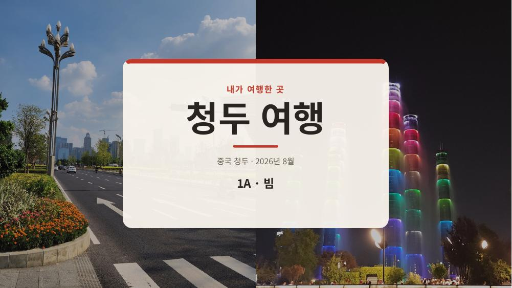
💡 กดขึ้นสไลด์นี้ก่อนเริ่มพูด มองผู้ฟังตอนพูดชื่อ ไม่ต้องมองจอ

**1. 안녕하세요? 저는 빔입니다.**
*อันนยองฮาเซโย? ชอนึน บีม-อิมนีดา*
🇹🇭 สวัสดีครับ ผมชื่อบีมครับ

**2. 지금부터 발표를 시작하겠습니다.**
*ชีกึมบูทอ พัลพโย-รึล ชีจัก-คาเกซซึมนีดา*
🇹🇭 ต่อจากนี้ผมจะเริ่มการนำเสนอครับ

### 발표 내용 ① 청두는 어떤 곳 · 언제 · 누구와 · 어떻게 (ตอบข้อ 1–2)

🎞️ สไลด์ 2 · 청두는 어떤 곳? (เฉิงตูเป็นเมืองแบบไหน) — บรรทัด 3–6 · ราว 30 วินาที
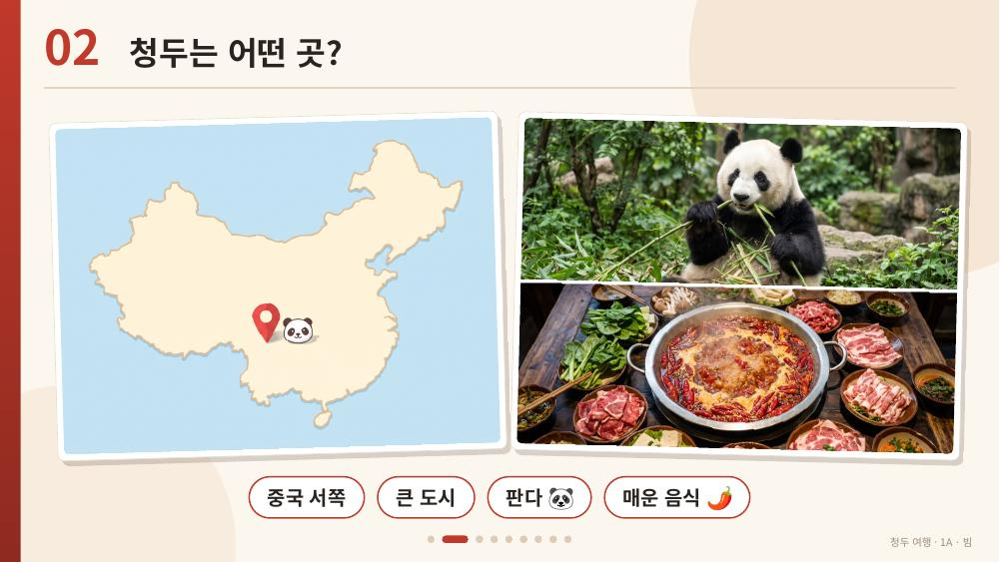
💡 ชี้หมุดบนแผนที่ตอนพูดข้อ 4 แล้วชี้รูปแพนด้ากับหม้อไฟตอนพูดข้อ 5

**3. 제가 여행한 곳은 중국 청두입니다.**
*เชกา ยอแฮง-ฮัน โก-ซึน ชุงกุก ชองดู-อิมนีดา*
🇹🇭 ที่ที่ผมไปเที่ยวมาคือเมืองเฉิงตูของจีนครับ

**4. 청두는 중국 서쪽에 있는 큰 도시입니다.**
*ชองดู-นึน ชุงกุก ซอจโจเก อินนึน คึน โทชี-อิมนีดา*
🇹🇭 เฉิงตูเป็นเมืองใหญ่ที่อยู่ทางตะวันตกของจีนครับ · ตอบ "어떤 곳이에요?"

**5. 청두는 판다와 매운 음식으로 유명합니다.**
*ชองดู-นึน พันดา-วา แมอุน อึมชิก-อือโร ยูมยองฮัมนีดา*
🇹🇭 เฉิงตูขึ้นชื่อเรื่องแพนด้ากับอาหารเผ็ดครับ · ตอบ "무엇이 유명해요?"

**6. 큰 쇼핑몰과 유명한 절도 많습니다.**
*คึน ชยอพิงมอล-กวา ยูมยองฮัน ชอลโด มันซึมนีดา*
🇹🇭 ห้างใหญ่กับวัดดังก็มีเยอะครับ · ตอบ "무엇이 있어요?"

🎞️ สไลด์ 3 · 언제? 누구와? 어떻게? (ไปเมื่อไร กับใคร ยังไง) — บรรทัด 7–10 · ราว 34 วินาที
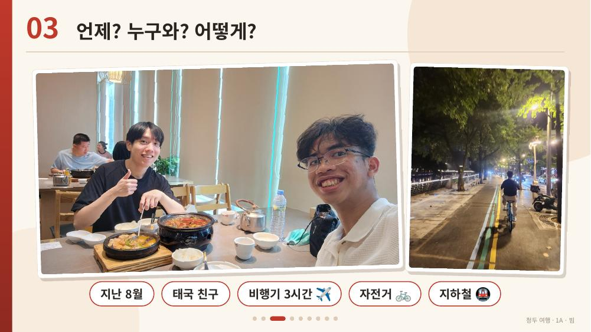
💡 ชี้รูปเพื่อนตอนพูดข้อ 7 และชี้รูปจักรยานตอนพูดข้อ 9 ป้ายคำด้านล่างเรียงตามลำดับที่ต้องพูดพอดี

**7. 저는 지난 8월에 태국 친구와 같이 갔습니다.**
*ชอนึน ชีนัน พัลวอเร แทกุก ชินกู-วา คาชี กัซซึมนีดา*
🇹🇭 ผมไปเมื่อเดือนสิงหาคมที่ผ่านมา กับเพื่อนคนไทยครับ · ตอบ "언제 여행했어요?" และ "누구와 같이 여행했어요?"

**8. 방콕에서 청두까지 비행기로 3시간쯤 걸렸습니다.**
*พังคก-เอซอ ชองดู-กาจี พีแฮงกี-โร เซชีกันจึม คอลรยอซซึมนีดา*
🇹🇭 จากกรุงเทพถึงเฉิงตู นั่งเครื่องบินประมาณ 3 ชั่วโมงครับ · ตอบ "어떻게 갔어요?" และ "얼마나 걸렸어요?"

**9. 청두에서는 자전거와 지하철을 탔습니다.**
*ชองดู-เอซอนึน ชาจอนกอ-วา ชีฮาชอ-รึล ทัซซึมนีดา*
🇹🇭 ที่เฉิงตูผมปั่นจักรยานและนั่งรถไฟใต้ดินครับ · ตอบ "어떻게 갔어요?" ในตัวเมือง

**10. 지하철이 아주 빨라서 좋았습니다.**
*ชีฮาชอ-รี อาจู ปัลลาซอ โชอัซซึมนีดา*
🇹🇭 รถไฟใต้ดินเร็วมาก เลยดีครับ · ตอบ "무엇이 좋았어요?"

### 발표 내용 ② 무엇을 했어요 (ตอบข้อ 3)

🎞️ สไลด์ 4 · 판다? → 쇼핑몰! (มุกของเรื่อง) — บรรทัด 11–12 · ราว 19 วินาที
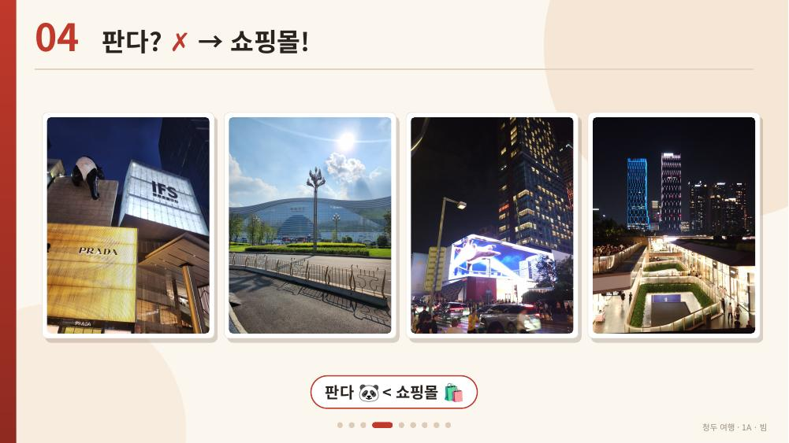
💡 ข้อ 11 คือมุก พูดจบแล้วหยุด 2 วินาทีให้คนหัวเราะ ชี้แพนด้าบนตึกในรูปซ้ายสุด แล้วค่อยพูดข้อ 12

**11. 그런데 저는 판다를 보러 가지 않았습니다.**
*คือรอนเด ชอนึน พันดา-รึล โพรอ คาจี อานัซซึมนีดา*
🇹🇭 แต่ว่า… ผมไม่ได้ไปดูแพนด้าเลยครับ (ยิ้ม แล้วเว้นจังหวะให้คนฟังหัวเราะ)

**12. 판다보다 쇼핑몰에 더 많이 갔습니다.**
*พันดา-โบดา ชยอพิงมอ-เร ทอ มานี กัซซึมนีดา*
🇹🇭 ผมไปห้างมากกว่าไปดูแพนด้าอีกครับ · ตอบ "무엇을 했어요?"

🎞️ สไลด์ 5 · 절 · 박물관 (วัด พิพิธภัณฑ์) — บรรทัด 13 · ราว 9 วินาที
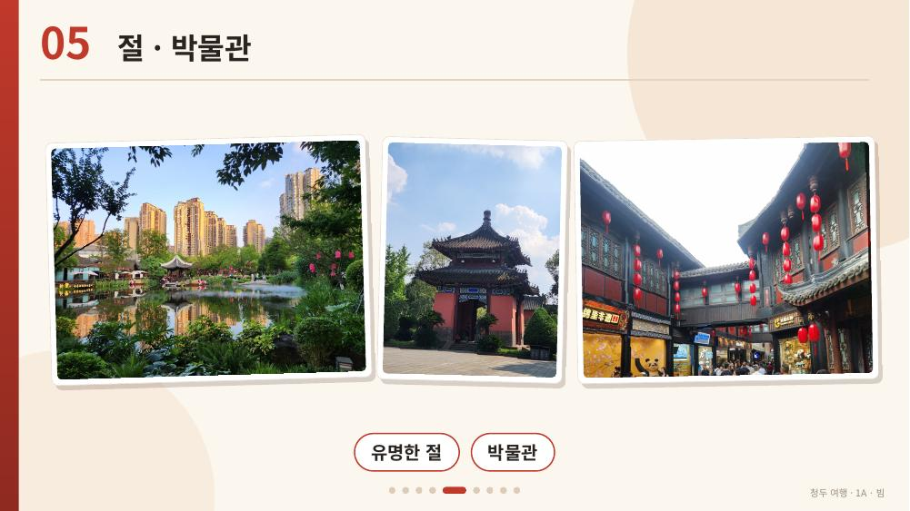
💡 สไลด์นี้สั้นที่สุด พูดประโยคเดียวแล้วไปต่อ ถ้าครูถามถึงรูปขวา ตอบว่า 옛날 거리예요

**13. 유명한 절과 박물관에도 갔습니다.**
*ยูมยองฮัน ชอล-กวา พังมุลกวา-เนโด กัซซึมนีดา*
🇹🇭 ไปวัดดังกับพิพิธภัณฑ์ด้วยครับ

🎞️ สไลด์ 6 · 제일 좋았습니다: 인민공원 (ที่ชอบที่สุด และสิ่งที่ลำบาก) — บรรทัด 14–17 · ราว 40 วินาที
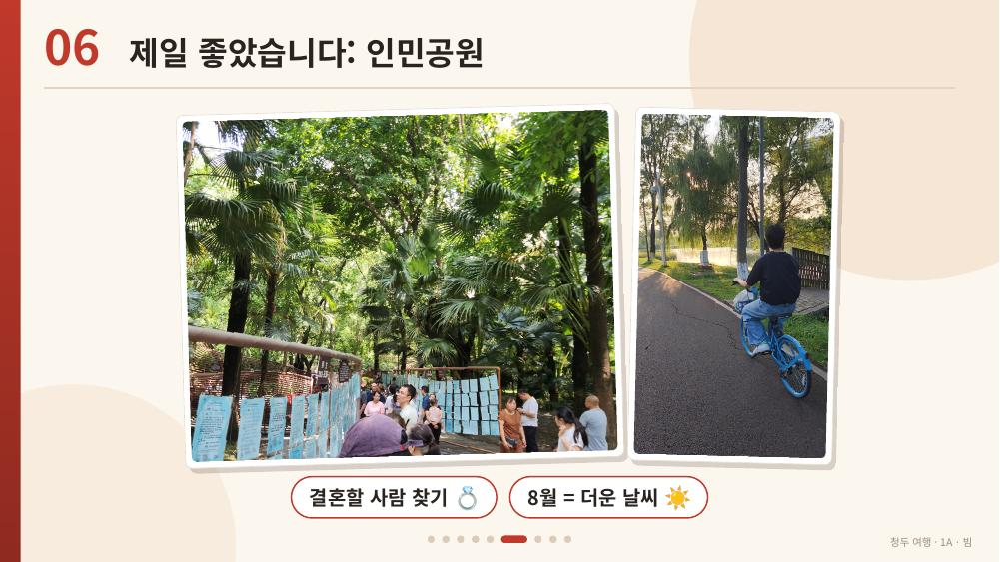
💡 ข้อ 15 เป็นประโยคยาวที่สุด พูดช้า ๆ แล้วชี้แผงป้ายสีฟ้าในรูปซ้าย ข้อ 17 ชี้รูปปั่นจักรยาน

**14. 저는 인민공원이 제일 좋았습니다.**
*ชอนึน อินมินกงวอ-นี เชอิล โชอัซซึมนีดา*
🇹🇭 ผมชอบสวนสาธารณะประชาชนที่สุดครับ · ตอบ "무엇이 좋았어요?"

**15. 그 공원에서는 부모님들이 아들, 딸과 결혼할 사람을 찾습니다.**
*คือ คงวอ-เนซอนึน พูโมนิมดือ-รี อาดึล, ตัล-กวา คยอรน-ฮัล ซารา-มึล ชัซซึมนีดา*
🇹🇭 ที่สวนนั้น พ่อแม่มาหาคนที่จะแต่งงานกับลูกชายลูกสาวครับ

**16. 처음 봐서 정말 재미있었습니다.**
*ชออึม บวาซอ ชองมัล แชมีอิซซอซซึมนีดา*
🇹🇭 เพิ่งเคยเห็นเป็นครั้งแรก สนุกมากครับ

**17. 8월에는 날씨가 아주 더워서 좀 힘들었습니다.**
*พัลวอเร-นึน นัลซี-กา อาจู ทอวอซอ ชม ฮิมดือรอซซึมนีดา*
🇹🇭 เดือนสิงหาคมอากาศร้อนมาก เลยลำบากหน่อยครับ · ตอบ "날씨가 어때요?" และ "무엇이 힘들었어요?"

### 발표 내용 ③ 음식 · 쇼핑 · 여행이 어땠어요 (ตอบข้อ 4–6)

🎞️ สไลด์ 7 · 무슨 음식을 먹었습니까? (อาหาร) — บรรทัด 18–19 · ราว 18 วินาที
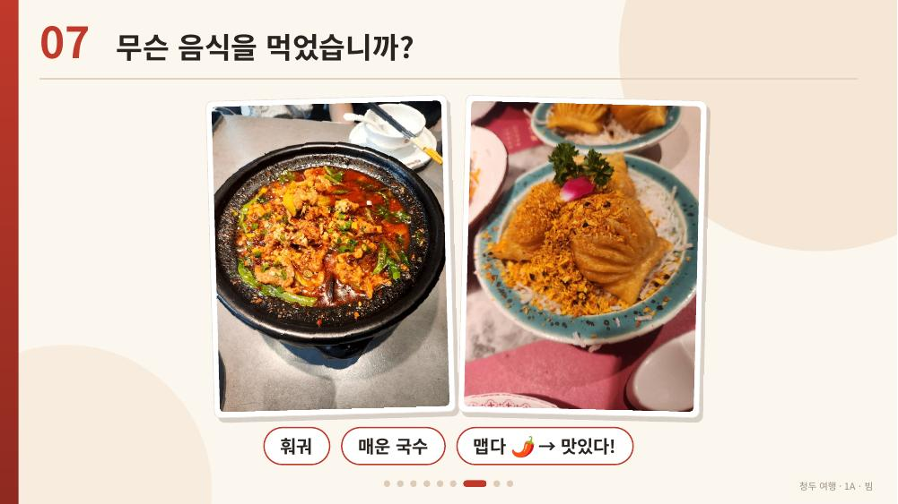
💡 รูปคือหม้อเผ็ดกับขนมทอด ไม่ใช่หม้อไฟกับบะหมี่ตามบท ถ้าครูถาม ชี้กลับไปที่รูปหม้อไฟในสไลด์ 2 ได้

**18. 음식은 훠궈와 매운 국수를 먹었습니다.**
*อึมชิ-กึน ฮวอกวอ-วา แมอุน กุกซู-รึล มอกอซซึมนีดา*
🇹🇭 ส่วนอาหาร ผมกินหม้อไฟหมาล่ากับบะหมี่เผ็ดครับ · ตอบ "무슨 음식을 먹었어요?"

**19. 아주 매웠지만 정말 맛있었습니다.**
*อาจู แมวอซจีมัน ชองมัล มาชิซซอซซึมนีดา*
🇹🇭 เผ็ดมาก แต่อร่อยจริง ๆ ครับ · ตอบ "맛이 어땠어요?"

🎞️ สไลด์ 8 · 쇼핑 · 여행이 어땠습니까? (ช้อปปิ้ง และสรุปทริป) — บรรทัด 20–22 · ราว 31 วินาที
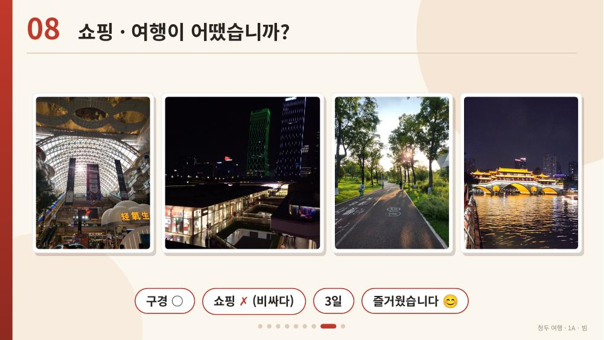
💡 สองรูปซ้ายคือห้าง ใช้ตอนข้อ 20 สองรูปขวาคือบรรยากาศเมือง ใช้ตอนข้อ 21–22

**20. 쇼핑몰은 많이 구경했지만 물건이 비싸서 사지 않았습니다.**
*ชยอพิงมอ-รึน มานี คูกยองแฮซจีมัน มุลกอ-นี พีซาซอ ซาจี อานัซซึมนีดา*
🇹🇭 เดินดูห้างเยอะ แต่ของแพงเลยไม่ได้ซื้อครับ · ตอบ "쇼핑을 했어요?" "무엇을 샀어요?" และ "왜 샀어요?" (ในที่นี้คือทำไมไม่ซื้อ)

**21. 청두는 구경할 곳이 많아서 좋았습니다.**
*ชองดู-นึน คูกยองฮัล โกซี มานาซอ โชอัซซึมนีดา*
🇹🇭 เฉิงตูมีที่ให้เที่ยวชมเยอะ เลยดีครับ · ตอบ "그곳이 어땠어요?"

**22. 3일은 짧았지만 정말 즐거웠습니다.**
*ซามี-รึน ชัลบัดจีมัน ชองมัล ชึลกอวอซซึมนีดา*
🇹🇭 3 วันอาจจะสั้น แต่สนุกมากจริง ๆ ครับ · ตอบ "여행이 어땠어요?"

🎞️ สไลด์ 9 · 마무리 (ปิด) — บรรทัด 23–24 · ราว 37 วินาที
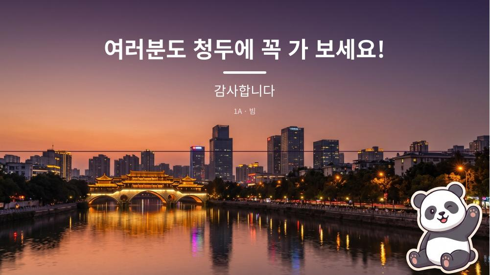
💡 ข้อ 23 จบด้วยมุก 저는 못 봤습니다! ยิ้มแล้วค่อยพูดประโยคปิดในข้อ 24

**23. 여러분도 청두에 꼭 가 보세요. 판다도 꼭 보세요. 저는 못 봤습니다!**
*ยอรอบุน-โด ชองดู-เอ กก คา โบเซโย. พันดา-โด กก โบเซโย. ชอนึน มด บวัซซึมนีดา!*
🇹🇭 ทุกคนลองไปเฉิงตูดูนะครับ แพนด้าก็ไปดูด้วยนะครับ ผมไม่ได้ดู!

### 발표 마무리 (ปิด)

**24. 지금까지 청두 여행을 발표했습니다. 그럼 이것으로 발표를 마치겠습니다. 들어 주셔서 감사합니다.**
*ชีกึมกาจี ชองดู ยอแฮง-อึล พัลพโยแฮซซึมนีดา. คือรอม อีกอ-ซือโร พัลพโย-รึล มาชีเกซซึมนีดา. ทือรอ จูชยอซอ คัมซาฮัมนีดา*
🇹🇭 ที่ผ่านมาคือการนำเสนอเรื่องเที่ยวเฉิงตูครับ ถ้าอย่างนั้นขอจบการนำเสนอเพียงเท่านี้ ขอบคุณที่ตั้งใจฟังครับ

---

## ✍️ ข้อ 2 · ฉบับเขียนลงกรอบใบงาน (แบบย่อหน้าตาม <보기>)

ใบงานหน้า 2 ให้เขียนเป็นย่อหน้าในกรอบ 3 ช่อง ประโยคเหมือนบทพูดด้านบนทุกคำ แค่เรียงต่อกันเป็นย่อหน้า

| 칸 | 쓸 내용 |
|:---|:---|
| **발표 시작** · บรรทัด 1–2 | 안녕하세요? 저는 빔입니다. 지금부터 발표를 시작하겠습니다. |
| **발표 내용 ¶1** · บรรทัด 3–10 | 제가 여행한 곳은 중국 청두입니다. 청두는 중국 서쪽에 있는 큰 도시입니다. 청두는 판다와 매운 음식으로 유명합니다. 큰 쇼핑몰과 유명한 절도 많습니다. 저는 지난 8월에 태국 친구와 같이 갔습니다. 방콕에서 청두까지 비행기로 3시간쯤 걸렸습니다. 청두에서는 자전거와 지하철을 탔습니다. 지하철이 아주 빨라서 좋았습니다. |
| **발표 내용 ¶2** · บรรทัด 11–17 | 그런데 저는 판다를 보러 가지 않았습니다. 판다보다 쇼핑몰에 더 많이 갔습니다. 유명한 절과 박물관에도 갔습니다. 저는 인민공원이 제일 좋았습니다. 그 공원에서는 부모님들이 아들, 딸과 결혼할 사람을 찾습니다. 처음 봐서 정말 재미있었습니다. 8월에는 날씨가 아주 더워서 좀 힘들었습니다. |
| **발표 내용 ¶3** · บรรทัด 18–23 | 음식은 훠궈와 매운 국수를 먹었습니다. 아주 매웠지만 정말 맛있었습니다. 쇼핑몰은 많이 구경했지만 물건이 비싸서 사지 않았습니다. 청두는 구경할 곳이 많아서 좋았습니다. 3일은 짧았지만 정말 즐거웠습니다. 여러분도 청두에 꼭 가 보세요. 판다도 꼭 보세요. 저는 못 봤습니다! |
| **발표 마무리** · บรรทัด 24 | 지금까지 청두 여행을 발표했습니다. 그럼 이것으로 발표를 마치겠습니다. 들어 주셔서 감사합니다. |

---

## 🔎 ทบทวนความยาก (ปรับเมื่อ 15 พ.ย.)

ร่างแรกมี 38 ประโยค ยากเกินระดับ 1 อยู่สามจุด ฉบับ 15 พ.ย. เช้าแก้แล้วเหลือ 31 ประโยค ฉบับนี้ย่อต่อเหลือ 24 บรรทัด (29 ประโยค) เพราะกระดาษ 발표 (2) หนึ่งแผ่นจุได้ 600 ช่อง

| จุดที่ยาก | ร่างแรก | ฉบับนี้ |
|:---|:---|:---|
| ศัพท์นอกหนังสือ 7 คำ | 오래된 · 선배 · 친해졌습니다 · 대나무 · 아무것도 · 이런 · 진짜 … 아니었지만 | เปลี่ยนเป็นคำที่เรียนแล้ว: 유명한 · 친구 · 사지 않았습니다 และตัดประโยคไผ่ออก |
| ชื่อสถานที่จีน 7 ชื่อ | 철상사 · 무후사 · 콴자이샹즈 · 안순교 · IFS · 타이구리 · SKP | เหลือชื่อเดียวคือ 인민공원 ที่เหลือพูดเป็น 쇼핑몰 · 절 · 박물관 |
| ประโยคซ้อนสองชั้น | 할아버지, 할머니들이 아들과 딸이 결혼할 사람을 찾고 있었습니다 | 부모님들이 아들, 딸과 결혼할 사람을 찾습니다 |

เพื่อให้พอดีกระดาษ ฉบับนี้ตัดออกคือ คำถาม 압니까 · 3일 동안 · 글로벌 센터 · 옛날 거리 · อาหารที่ขายริมทาง และประโยคยาวเรื่องวัดกับห้างตอนสรุป

ไวยากรณ์ทั้งหมดอยู่ในบท 5–37 ไม่มีตัวไหนเกินหลักสูตร คำนอกหนังสือที่ยังเหลือคือ 서쪽 (ใบงานของครูใช้ 남쪽 อยู่แล้ว) · 쇼핑몰 · 절 · 아들 · 딸 ซึ่งเป็นคำสั้นและจำเป็นต่อเรื่อง

ภาพรวมสไลด์อยู่ในหัวข้อ 🎞️ ด้านบน และไฟล์ฉายจริงคือ KMU_Speaking_TravelChengdu_Deck.pdf

---

## 🧾 ฉบับลอกลงกระดาษ 발표 (2) (원고지)

กระดาษ 발표 (2) มี 20 ช่องต่อแถว ด้านหน้า 14 แถว (ถึงช่องที่ 280) ด้านหลัง 16 แถว (ช่อง 300–600) รวม 600 ช่อง บทนี้ใช้ 30 แถวพอดีคือเต็มหนึ่งแผ่นทั้งหน้าและหลัง ลอกตามภาพได้ทีละช่อง ภาพแรกคือด้านหน้า ภาพที่สองคือด้านหลัง ย่อหน้าใหม่เว้นช่องแรก

⚠️ ห้ามเพิ่มคำ เพราะไม่มีแถวเหลือ ถ้าแก้ประโยคให้รัน `python3 scripts/wongoji.py travel_chengdu` ใหม่

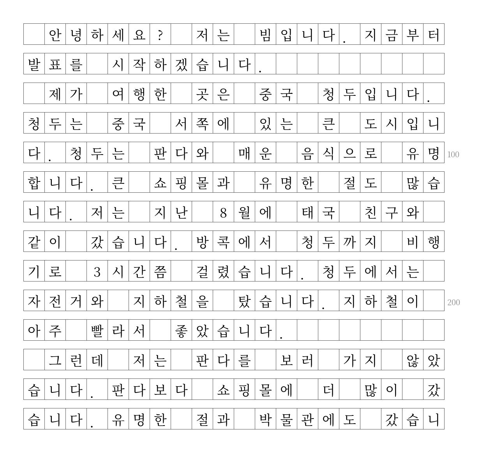

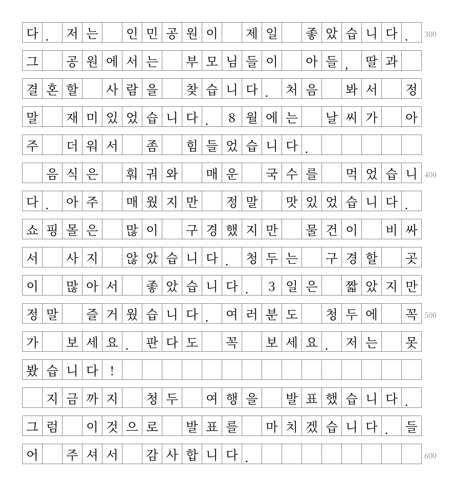

---

## ✅ เช็กไวยากรณ์ที่ใช้ (บท 5–37)

บทนี้ใช้ไวยากรณ์ของเล่ม 1-2 หลายตัว ตารางนี้บอกว่าแต่ละตัวอยู่ประโยคไหน

| ไวยากรณ์ (บท) | ประโยค | ส่วนที่ใช้ |
|:---|:---|:---|
| -(으)ㄴ กริยาอดีตขยายนาม (29과) | 3 | 여행**한** 곳 |
| -는 กริยาปัจจุบันขยายนาม (27과) | 4 | 있**는** 큰 도시 |
| -(으)ㄴ คุณศัพท์ขยายนาม (23과) | 4 · 5 · 6 · 18 | 큰 도시 · **매운** 음식 · **큰** 쇼핑몰 · **유명한** 절 · **매운** 국수 |
| -(으)ㄹ กริยาอนาคตขยายนาม (33과) | 15 · 21 | 결혼**할** 사람 · 구경**할** 곳 |
| N(으)로 유명하다 · พาหนะ (31과) | 5 · 8 | 음식**으로** 유명합니다 · 비행기**로** |
| N에서 N까지 · 걸리다 · 쯤 (31과) | 8 | 방콕**에서** 청두**까지** 3시간**쯤 걸렸습니다** |
| 르 불규칙 (32과) | 10 | **빨라서** |
| -아/어 보다 (35과) | 23 | 꼭 **가 보세요** |
| -아/어 주시다 (37과) | 24 | **들어 주셔서** |
| ㅂ 불규칙 (23과) | 17 · 19 · 22 | 더**워**서 · 매**웠**지만 · 즐거**웠**습니다 |
| -아/어서 เหตุผล (29과) | 10 · 16 · 17 · 20 · 21 | 빨라**서** · 봐**서** · 더워**서** · 비싸**서** · 많아**서** |
| -지만 (25과) | 19 · 20 · 22 | 매웠**지만** · 구경했**지만** · 짧았**지만** |
| 보다 (26과) | 12 | 판다**보다** 쇼핑몰에 더 많이 |
| 제일 (28과) | 14 | 인민공원이 **제일** 좋았습니다 |
| -(으)러 가다 (18과) | 11 | 판다를 보**러** 가지 않았습니다 |
| -지 않다 · 못 | 11 · 20 · 23 | 가**지 않았**습니다 · 사**지 않았**습니다 · **못** 봤습니다 |
| -겠- (สุภาพ/ตั้งใจ) | 2 · 24 | 시작하**겠**습니다 · 마치**겠**습니다 |
| N도 (ก็ · ด้วย) | 6 · 13 · 23 | 절**도** · 박물관에**도** · 여러분**도** · 판다**도** |

---

## ❓ คำถามที่ครูอาจถามต่อ (질문 연습)

หลังพูดจบ ครูมักถามต่อ 1–2 ข้อ คำตอบสั้น ๆ ต่อไปนี้ใช้ -아/어요 ได้ (ครูบอกว่าไม่ต้องพูดแบบทางการทุกประโยค)

| คำถาม | ไทย | ตอบ | ไทย |
|:---|:---|:---|:---|
| 왜 판다를 안 봤어요? | ทำไมไม่ไปดูแพนด้า | 시간이 없어서 못 봤어요. 다음에 꼭 볼 거예요. | ไม่มีเวลาเลยไม่ได้ดู ครั้งหน้าจะไปดูแน่นอน |
| 청두에 또 가고 싶어요? | อยากไปเฉิงตูอีกไหม | 네, 또 가고 싶어요. 다음에는 판다를 보고 싶어요. | อยากไปอีก ครั้งหน้าอยากดูแพนด้า |
| 무엇이 제일 맛있었어요? | อะไรอร่อยที่สุด | 훠궈가 제일 맛있었어요. | หม้อไฟอร่อยที่สุด |
| 훠궈가 많이 매웠어요? | หม้อไฟเผ็ดมากไหม | 네, 아주 매웠어요. 그렇지만 맛있었어요. | เผ็ดมาก แต่อร่อย |
| 친구하고 같이 여행해서 어땠어요? | เที่ยวกับเพื่อนเป็นยังไง | 같이 여행해서 정말 즐거웠어요. | ได้เที่ยวด้วยกัน สนุกมาก |
| 한국에서는 어디를 여행하고 싶어요? | ในเกาหลีอยากเที่ยวที่ไหน | 제주도에 가 보고 싶어요. 바다를 보고 싶어요. | อยากลองไปเชจู อยากดูทะเล |
| 중국말을 할 수 있어요? | พูดภาษาจีนได้ไหม | 아니요, 잘 못해요. 그래서 좀 힘들었어요. | พูดไม่ค่อยได้ เลยลำบากนิดหน่อย |

---

## 📚 คำศัพท์ (단어)

คำส่วนใหญ่เรียนแล้วในบท 5–37 คำที่มี 🆕 ยังไม่อยู่ในรายการศัพท์ของหนังสือ เหลือเพียง 4 รายการหลังปรับบทเมื่อ 15 พ.ย.

| คำ | ความหมาย | หมายเหตุ |
|:---|:---|:---|
| 청두 | เฉิงตู | ชื่อเมือง อ่าน [청두] |
| 도시 | เมือง | 28과 |
| 서쪽 🆕 | ทิศตะวันตก | 서 (ตะวันตก) + 쪽 (ทาง) · 쪽 เรียนแล้วใน 오른쪽 · 왼쪽 |
| 판다 | แพนด้า | |
| 유명하다 | มีชื่อเสียง | N(으)로 유명하다 = ขึ้นชื่อเรื่อง N |
| 쇼핑몰 🆕 | ห้างสรรพสินค้า (แบบมอลล์) | 백화점 ก็ใช้ได้ |
| 절 🆕 | วัด | คำสั้น พูดช้า ๆ ให้ชัด |
| 부모님 | พ่อแม่ | 15과 |
| 아들 · 딸 🆕 | ลูกชาย · ลูกสาว | |
| 박물관 | พิพิธภัณฑ์ | 31과 · อ่าน [방물관] |
| 자전거 | จักรยาน | 자전거를 타다 = ปั่นจักรยาน |
| 구경하다 | เที่ยวชม เดินดู | 구경만 하다 = ดูอย่างเดียว · 구경할 곳 = ที่ให้เที่ยวชม |
| 결혼하다 | แต่งงาน | 결혼할 사람 = คนที่จะแต่งงานด้วย |
| 훠궈 | หม้อไฟจีน (หมาล่า) | |
| 국수 | บะหมี่ ก๋วยเตี๋ยว | 35과 |
| 물건 | สิ่งของ | |
| 즐겁다 | สนุก | ㅂ 불규칙 → 즐거웠습니다 · 35과 |
| 짧다 | สั้น | อ่าน [짤따] |

**ชื่อสถานที่ (อ่านแบบเกาหลี):** 인민공원 (People's Park) — ชื่อสถานที่อื่นตัดออกแล้วเพราะออกเสียงยากและผู้ฟังไม่รู้จัก ถ้าครูถาม ตอบชื่อได้: 박물관 = 무후사 (武侯祠)

---

## ⚠️ จุดที่ต้องระวังตอนพูด

### 1. 걸렸습니다 ไม่ใช่ 거렸습니다
매일시험 31과 เขียน 거려요 สี่ครั้งเสีย 2 คะแนน · 걸리다 มี ㄹ ใต้ 거 เสมอ → 3시간쯤 **걸렸**습니다 [걸렫씀니다]

### 2. ㅂ 불규칙 ใช้ 워 ไม่ใช่ 와
덥다 → 더**워**서 · 맵다 → 매**웠**지만 · 즐겁다 → 즐거**웠**습니다 (✗ 더와서 · มีแค่ 돕다 · 곱다 ที่ใช้ 와)

### 3. 르 불규칙 ต้องเติม ㄹ
빠르다 → **빨라서** (✗ 빠라서 · ✗ 바라서 — ㅃ ไม่ใช่ ㅂ)

### 4. การออกเสียงที่มักพลาด
있는 [인는] · 많습니다 [만씀니다] · 박물관 [방물관] · 결혼 [겨론] · 짧았지만 [짤받찌만] · 찾습니다 [찯씀니다]

### 5. ซ้อมพูด
พูดช้า ๆ ทีละประโยค เว้นจังหวะหลังข้อ 11 (판다를 보러 가지 않았습니다) ให้คนฟังหัวเราะก่อนพูดข้อ 12 ต่อ

---

## ❔ ส่วนที่ร่างจากการคาดเดา (ช่วยยืนยันหรือแก้)

ข้อมูลเหล่านี้ผู้ร่างเดาเอง ถ้าไม่ตรงกับความจริงให้แก้ก่อนลอกลงกระดาษ ยกเว้นข้อ 4 ที่ผู้ใช้ยืนยันแล้ว

1. **ชอบอะไรที่สุด (ข้อ 14):** ใส่ 인민공원 ไว้ ถ้าชอบที่อื่นมากกว่า ให้เปลี่ยนชื่อในประโยค 14
2. **อะไรลำบาก (ข้อ 17):** ใส่ "อากาศร้อนเลยลำบาก" ไว้ ทางเลือกอื่น: 중국말을 몰라서 좀 힘들었습니다 (ไม่รู้ภาษาจีนเลยลำบาก)
3. **ทำไมไม่ซื้อของ (ข้อ 20):** ใส่ "ของแพง" ไว้ ทางเลือกอื่น: 가방이 작아서 (กระเป๋าเล็ก)
4. **ไปกับใคร (ข้อ 7):** ✅ ผู้ใช้ยืนยันแล้วว่าใช้ 친구 (เปลี่ยนจาก 선배 เพราะ 선배 ไม่อยู่ในหนังสือ) ไม่ต้องแก้อะไรอีก
